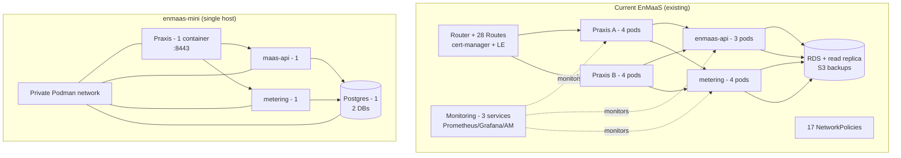

# EnMaaS vs enmaas-mini: architecture comparison and production-readiness

> Status: draft architecture comparison to decide the production-grade single-SKU EnMaaS.

---

## Summary

Existing EnMaaS (`EnMaaS-opps`, internal) runs in OpenShift as two namespaces (`enmaas`, `enmaas-monitoring`) with redundant deployments, ingress routes, cert-manager, managed databases, and full observability. `enmaas-mini` (`periwinkle`) collapses the same request path into one RHEL host with rootless Podman Quadlets and a bundled PostgreSQL container, shippable as a bootc VM appliance. The dependency reduction is real and is the correct direction. The remaining gap is that mini replaces many replicas with one of each and calls that a deployment — a topology change, not just a footprint change — and silently moves every availability, durability, and observability property into the "later" bucket. This document maps the building blocks, their requirements, and what production grade must mean before we lock the SKU.

---

## 1. Building blocks

### 1.1. Existing EnMaaS (production reference)

**Namespaces:** `enmaas` and `enmaas-monitoring` rendered from `EnMaaS-opps/base/projects/` via `oc process --param-file clusters/<env>/params/enmaas.params` (`make render`, `make diff`).

```
                    ┌───────────────────── OpenShift / ROSA ─────────────────────┐
 Browser / Client ─▶ │ Router: 28 Routes, edge TLS, cert-manager + LE, A/B weights│
                    │         │                                                   │
                    │         ▼                                                   │
                    │  Praxis-A (4 replicas) ── weighted flip ──▶ Praxis-B (4)  │
                    │   api_key_auth → model_catalog → external_metering →       │
                    │   credential_injection → LB (OpenAI / GLM / Vertex)        │
                    │         │                      │                           │
                    │         ▼                      ▼                           │
                    │  enmaas-api (3 pods)     metering-service (4 pods)        │
                    │  keys, validation          USD, QoS, rollups, dashboards   │
                    │         │                      │                           │
                    │  maas-api (legacy, 2 pods — not rendered in prod/stage)   │
                    │         └──────────┬───────────┘                           │
                    │                    ▼                                       │
                    │  RDS PostgreSQL (prod since 2026-09-30) + read replica    │
                    │  S3 backups with AWS IAM role                            │
                    │                                                            │
                    │  enmaas-monitoring: Prometheus / Alertmanager / Grafana    │
                    │  + GitHub OAuth, RDS postgres exporter, SLO dashboards    │
                    │  17 NetworkPolicies, 3 CRDs, 3 Certificates                │
                    └────────────────────────────────────────────────────────────┘
```

Detailed responsibilities:

| Block | Purpose | Key details (`EnMaaS-opps`) |
|-------|---------|------------------------------|
| **Edge / routing** | Public ingress, TLS termination, path dispatch | 28 `Route`s in `routes*.yaml` (`/health`, `/v1/chat/completions`, `/v1/messages`, `/v1/responses`, `/v1/models`, `/v1/conversations`, dashboard APIs), `termination: edge`, `haproxy.router.openshift.io/timeout: 300s`, `externalCertificate: enmaas-public-tls`, `alternateBackends` weighted A=`${PRAXIS_A_WEIGHT}` / B=`${PRAXIS_B_WEIGHT}` |
| **Gateway (Praxis)** | Auth, model selection, metering, forwarding | `praxis-slot.template.yaml:22` 4 replicas per slot × 2 slots, `praxis-config.template.yaml:42` filter chains (`api_key_auth` cache 300s, `model_catalog`, `intelligent_route`, `gcp_adc` via `vertex-sa-key`, `external_metering` with `M2M_AUTH` to `metering-service:8080`, `allow_private_endpoint: true`, `credential_injection` from `provider-credentials`, `load_balancer` with `sni` and `idle_timeout_ms: 45000`); A/B candidate configs `praxis-qos-prod*` |
| **Key service** | Finite-lived API keys, validation, identity | `enmaas-api.template.yaml:28` 3 replicas, init-container `python -m app.migrate`, anti-affinity, `imagePullSecrets: enmaas-api-pull`, `DATABASE_URL` from `maas-db-config`, `API_KEY_MAX_EXPIRATION_DAYS=90`, `TENANT=models-as-a-service`; legacy `maas-api.template.yaml:22` 2 replicas `MAAS_SUBSCRIPTION_MODE=standalone` not rendered in prod |
| **Metering** | USD budgets, QoS, rollups, dashboards, admin APIs | `metering-service.template.yaml:22` 4 replicas (prod param), `METERING_MODE=api`, `DATABASE_URL` + `READ_DATABASE_URL` via `metering-readonly-db-url`, `M2M_AUTH_REQUIRED=true` via `metering-internal-auth`, `DASHBOARD_USE_ROLLUPS=true`, `LIVE_ROLLUPS_ENABLED`, `QOS_ENABLED=true`, many partner API secrets |
| **Data** | Persistence for keys, metering, ledger | RDS `pricetag-enmaas-cnpg-624013087577-usw2` reached via `RDS_EGRESS_CIDR=10.0.0.0/16`, S3 `s3.us-west-2.amazonaws.com/${COS_BUCKET}`, `AWS_ROLE_ARN=arn:aws:iam::624013087577:role/pricetag-enmaas-cnpg-backup`, `STORAGE_CLASS=gp3-csi` |
| **Security** | Certs, network, container hardening | `certificates.yaml:14` 3 certs `letsencrypt-prod` ECDSA 256, `duration: 2160h`, `renewBefore: 720h`; 17 `NetworkPolicy` objects including `default-deny`; containers `allowPrivilegeEscalation: false`, `readOnlyRootFilesystem: true`, `capabilities.drop: [ALL]`, `seccomp: RuntimeDefault`, `runAsNonRoot: true`; secrets out-of-band, GitHub OAuth for monitoring |
| **Observability** | Metrics, logs, alerts, dashboards | `enmaas-monitoring/` 14 templates, Prometheus/Alertmanager/Grafana, oauth proxies, `05-scrape-rbac.yaml` for `prometheus.io/scrape` annotations, RDS exporter (via `pricetag`), Grafana dashboards for performance/SRE/RDS, synthetics and `sop/` runbooks |
| **Ops** | Rendering, smoke tests, drift control | `Makefile` `render`/`diff`, `rendered/` committed for SRE, `make smoke` mints a key via metering API, probes GLM/Claude/OpenAI, revokes key; `docs/sop/` for health checks, provider latency, RDS cutover |

### 1.2. enmaas-mini (periwinkle, current plan)

One RHEL host, no cluster:

```
 Browser / Client ─▶ ┌──────────── RHEL 9.6 bootc host ──────────────────────┐
                     │ Praxis :8443 — TLS terminates here (private CA)      │
                     │  generated config, no router                          │
                     │        │                  │                           │
                     │        ▼                  ▼                           │
                     │  maas-api (Go)     metering-service (Go)             │
                     │  standalone profile  USD, 10B token gate, UI         │
                     │        │                  │                           │
                     │        └────────┬─────────┘                           │
                     │                 ▼                                     │
                     │  one PostgreSQL container, two DBs                    │
                     │  (optional: two external DBs, `--maas-database-url-file`/`--metering-...`)│
                     │                                                       │
                     │  rootless Podman + systemd Quadlets (praxis-svc)     │
                     │  Podman secrets, private Podman network              │
                     └───────────────────────────────────────────────────────┘
```

| Block | Purpose | mini details (periwinkle) |
|-------|---------|---------------------------|
| **Edge / routing** | Same Praxis auth/model/metering pipeline | `docs/testing/pricetag.md:5` only `8443` public; Praxis generates unified chains `scripts/pricetag/prepare.py` / `scripts/common/unified_config.py`; validated by `bootc/systemd/` |
| **Gateway** | Single container, generated config | `bootc/README.md:5` `praxis` image `RHEL 9 bootc`, `configs/all-in-one/` + `configs/pricetag/`; `docs/quickstarts/remote-gateway/README.md:14` rootless `praxis-svc`, Quadlets |
| **Key service** | `maas-api` standalone | `maas-api/README.md:14` `MAAS_DEPLOYMENT_PROFILE=enmaas`, `DATABASE_URL`/`DB_CONNECTION_URL`, plain HTTP metrics, no CRDs |
| **Metering** | PriceTag fork, published images | `docs/quickstarts/remote-gateway-pricetag/images.md:5` `quay.io/redhat-et/secure-single-server-*` pinned digests; `docs/testing/pricetag.md:27` 90-day key TTL, 10B safety gate, 15s quota cache |
| **Data** | One local Postgres | Default 1 container 2 DBs; `--maas-database-url-file` / `--metering-database-url-file` for two external DBs (both required together) |
| **Security** | Private CA, Podman secrets, loopback admin | `docs/testing/pricetag.md:53` `M2M_SHARED_SECRET`, `pricing` secrets, trusted-peer loopback; `docs/quickstarts/remote-gateway/README.md:32` `praxis-svc` locked, root-owned policy |
| **Observability** | None bundled | `docs/quickstarts/remote-gateway-pricetag/architecture.md:235` "Replication, backup and recovery still require explicit configuration" |
| **Ops** | Workstation-driven install | `scripts/pricetag/install --hostname $GATEWAY_HOST`, `scripts/pricetag/maas-key`, `scripts/pricetag/user`, `bootc switch IMAGE:TAG` |

### 1.3. Visual comparison (mermaid)



---

## 2. Deployment requirements and dependencies

| Dimension | Current EnMaaS | mini today | Change |
|-----------|----------------|------------|--------|
| **Platform** | OpenShift / ROSA, `oc`, Router, cert-manager operator, CNPG or RDS access, `make render` | RHEL 9.6 x86_64 bootc-managed host, `podman`, `systemd`, `bootc` | Removes cluster control plane; moves burden to host |
| **Compute** | Dedicated cluster nodes, Praxis `2CPU/4Gi` per pod × 8, similar for API/metering/exporters | 8 vCPU / 32 GiB / 150 GiB tested (`docs/quickstarts/remote-gateway-pricetag/README.md:15`); no GPU unless vLLM | ~80% smaller footprint |
| **Data** | Managed DB (RDS) + read replica + S3 backup bucket + IAM role, `gp3-csi` | Local Postgres container (or two user-provided external DBs) | Removes external managed data tier |
| **Network** | Router + 28 path Routes, `NetworkPolicy` default-deny, 443 egress to providers, 5432 to RDS, 6443/443 to K8s API | Only `8443` public; host loopback admin; 443 egress to providers | Simpler, loses per-policy isolation |
| **TLS** | cert-manager + Let's Encrypt ECDSA, auto-renew 720h before 2160h expiry, `externalCertificate: enmaas-public-tls` | Private CA, server cert, manual `GATEWAY_HOST` rotation | No auto-renew; CA distribution |
| **Identity** | MaaS finite keys + PriceTag OIDC-capable dashboards, role checks, team scopes | Finite keys only, no OIDC, revoke ≠ session logout | Reduced IdP matrix |
| **Observability** | Managed Prometheus/Grafana/AM + exporters + SLO dashboards + synthetics | None | Must be rebuilt or externalized |
| **Ops** | `make diff/render/print`, AppSRE saas, SOPs, backup/restore runbooks | `scripts/pricetag/install`, Quadlets, `bootc switch`, `scripts/pricetag/api|manage` | Fresh-host install only |
| **Supply chain** | Digest-pinned images, internal registry, Quay mirrors, SBOM TBD | Digest-pinned published images + bootc builds | Needs signing/release process |
| **Air-gap** | Not air-gap ready | Not air-gap ready; bootc pulls on first boot | Needs mirror/bundle for either |

### Eliminated dependencies (mini advantage)

No OCP Router, no cert-manager/OLM, no CNPG/operator on cluster, no `NetworkPolicy` controller, no persistent-volume subsystem, no cluster RBAC/OLM, no monitoring stack.

### Re-introduced or hidden dependencies

Single host administrator, host SSH, private CA trust, Podman private network trust, local disk durability, and — if air-gap — a registry mirror and price-snapshot fetch.

---

## 3. What production grade must mean

Production grade is a contract across eight dimensions. A plausible v1 target is a **single-node appliance that is production-grade with an explicit non-HA boundary** — external DB optional, bundled monitoring, backup/restore, and upgrade/rollback included.

| Dimension | Production-grade v1 target | v2 candidate | Risk if cut in v1 |
|-----------|----------------------------|--------------|-------------------|
| **Availability** | Single-node, documented RTO, systemd restart, watchdog, fast reboot; optional external DB for DB HA | Multi-node gateway, multi-replica Postgres, load balancer | A host loss is an outage — the contract must say so |
| **Durability** | Automated backup, tested restore, RPO/RTO, retention policy, point-in-time recovery | Multi-region, PITR to external store | Data loss without backup |
| **Security** | Rootless, non-root, read-only FS, dropped caps, seccomp, secrets in Podman secrets, TLS 1.2+, authenticated admin, CVE/SBOM, signed images, audit | FIPS/STIG, mTLS internal, OIDC/SSO, HSM, SLSA | Secrets on disk, weak TLS |
| **Performance** | Published SLO: p95 latency, rps, users, tokens/day; benchmark at target size | Autoscaling, per-tenant fairness | Unknown capacity, surprise throttling |
| **Scale** | Vertical scale validated; stateless restartable; DB limits documented | Horizontal scale-out, sharding | Capacity ceiling surprise |
| **Operations** | Install, upgrade, rollback, cert rotation, key rotation, backup/restore, log retention, health checks | Online live migration, rolling upgrades | Cannot support customers |
| **Observability** | Metrics, logs, alerts for gateway/key/metering/DB, dashboard, synthetic probes | SRE runbooks, error-budget burndown | Blind during outage |
| **Supportability** | RHEL lifecycle, pinned digests, compatibility matrix, air-gap story, release cadence, docs | Long-term support branches | Upgrade breaks |

**Hard requirement:** a single VM cannot be highly available. Make it resilient, not imaginary, and publish the SLO (e.g., 99.5% with maintenance windows). Customers accept a single-node contract; they do not accept discovering it after downtime.

**Recommended v1 cuts:** No multi-node HA, no OIDC, no autoscaling, no multi-region, no provider UI, no default vLLM GPU.

**Do not cut in v1:** Backup/restore, upgrade/rollback, monitoring/alerts, cert rotation, security hardening, performance SLO.

---

## 4. Big architecture decisions to lock before implementation

1. **SKU form** — bootc VM appliance (recommended), container bundle, or both? Bootc VM as the product with containers inside gives a single artifact and preserved layer pinning.
2. **HA boundary** — single node with optional external DB vs. deferred multi-node. Drives the entire data tier.
3. **Database** — bundled Postgres vs. external managed DB. Bundled is simpler; external is the only credible HA path.
4. **TLS** — private CA only, customer-provided cert, or ACME/Let's Encrypt. Production usually needs a real cert story.
5. **Identity** — local MaaS keys only vs. OIDC/SSO. Existing EnMaaS is OIDC-capable; mini has no IdP.
6. **Observability** — bundle a minimal Prometheus/Grafana/Alertmanager or export to customer monitoring. Bundling closes the largest production gap.
7. **Upgrade model** — in-place `bootc switch`, blue/green VM, or package update. Current repo is fresh-host only.
8. **Scale target** — users, rps, tokens/day, DB size. Without targets, performance and scale are untestable.
9. **Air-gap** — internal registry mirror, preloaded images, offline price snapshot, internal CA. Bootc pulls on first boot — not air-gap native.
10. **Support boundary** — what is Red Hat-supported vs. experimental (`README.md:11` "experimental demonstration"), lifecycle, and fix cadence.

---

## 5. Local validation plan for a development laptop

Images are `linux/amd64` (`docs/quickstarts/remote-gateway-pricetag/images.md:38`), so Apple Silicon laptops need x86_64 virtualization or a remote x86_64 host.

| Path | Purpose | How |
|------|---------|-----|
| **Functional (recommended)** | Key auth, budgets, dashboards, restart persistence | Lima/UTM Linux VM 8 vCPU / 16–32 GiB / 100 GiB, systemd + Podman, run the repo's `scripts/pricetag/install --hostname localhost` |
| **Image** | bootc lifecycle | Build `qcow2` with `bootc-image-builder`, boot in UTM/VMware Fusion (x86_64), test `bootc switch`, first-boot pulls, rollback |
| **Performance** | SLO validation without emulation distortion | x86_64 EC2/bare-metal; do not measure on emulated Arm |

### Validation checklist (before declaring ready)

1. Fresh install from a clean host.
2. Admin login, user creation, key issuance, budget enforcement, quota denial.
3. Provider routing for OpenAI and Anthropic dialects.
4. Reboot persistence (DB, keys, sessions, Quadlets).
5. Upgrade N → N+1 and rollback.
6. Backup → destroy → restore with row-count verification.
7. Certificate rotation and key rotation.
8. Failure injection: kill Praxis, kill metering, kill Postgres; verify fail-closed and recovery.
9. Load at target users/rps; record p95, error rate, DB growth, disk growth.
10. Security: no secrets in logs, read-only FS, non-root, exposed ports, TLS config.

### Naming

`enmaas-mini` / "mini-enmaas" implies a toy. For a production SKU, prefer **EnMaaS Server**, **EnMaaS Appliance**, or **EnMaaS Single Server** — the codebase already uses the latter (`docs/testing/pricetag.md:1`). `EnMaaS Edge` works only if the positioning is edge.

---

*Sources: `EnMaaS-opps/README.md`, `clusters/prod/params/enmaas.params`, `base/projects/enmaas/*.template.yaml`, `rendered/prod/enmaas.yaml`, `docs/architecture/`, periwinkle `bootc/README.md`, `docs/quickstarts/*`, `docs/testing/pricetag.md`, `maas-api/README.md`, `docs/quickstarts/remote-gateway-pricetag/images.md`.*
